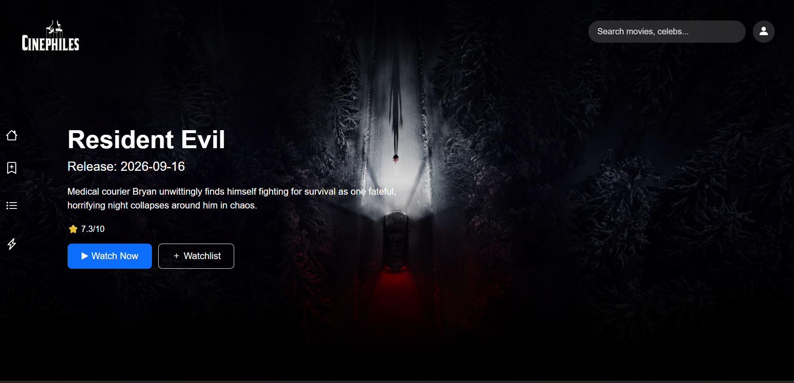
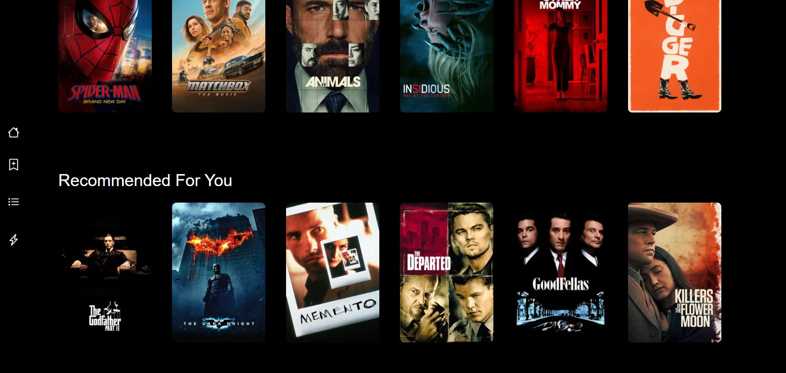
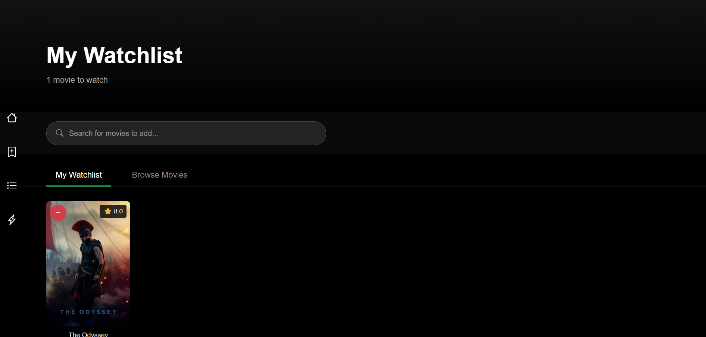
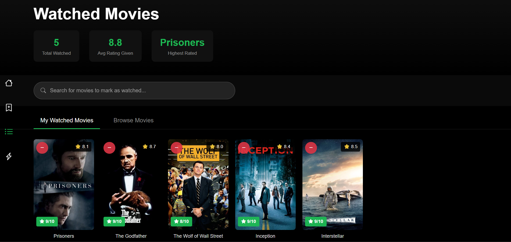
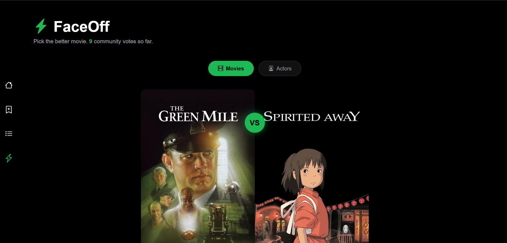

# Cinephiles

A full-stack movie platform for tracking what you've watched, building a watchlist, rating films, and settling debates with head-to-head "FaceOff" votes. It includes a hybrid recommendation engine that combines content-based filtering with a matrix factorization model implemented from scratch in NumPy.




## Contents

- [Features](#features)
- [Screenshots](#screenshots)
- [Architecture](#architecture)
- [Tech stack](#tech-stack)
- [Recommendation system](#recommendation-system)
- [Getting started](#getting-started)
- [API overview](#api-overview)
- [Database schema](#database-schema)
- [Design decisions and troubleshooting](#design-decisions-and-troubleshooting)
- [Limitations and roadmap](#limitations-and-roadmap)
- [Acknowledgments](#acknowledgments)

## Features

- **Accounts:** sign up and log in with JWT authentication; passwords are hashed with bcrypt.
- **Discover:** home page with a hero banner for the latest release plus popular and trending rows, and a multi-search across movies, TV shows and people.
- **Watchlist:** browse or search TMDB and add or remove movies, saved per user in the database.
- **Watched and ratings:** mark movies as watched and rate them 1-10, with stats (total watched, average rating given, highest rated) and sorting.
- **FaceOff:** pick the better of two movies, or the better of two actors from a curated pool of about 50 well-known names. Every vote is stored, and the results bars and leaderboard show community-wide win rates.
- **Recommended For You:** personalized picks built from your own ratings using the hybrid recommender (see below).

## Screenshots


### Home

*Hero banner, popular and trending rows, and the "Recommended For You" row.*

### Search

*Multi-search across movies, TV and people with detail modals.*

### Watchlist

*Browse and search TMDB, then add movies to a per-user watchlist.*

### Watched and ratings

*1-10 star rating modal, stats and sorting.*

### FaceOff


*Head-to-head voting with community win rates and a leaderboard.*


## Architecture

```text
 Browser (HTML / CSS / vanilla JS, Bootstrap 5)
        |
        |  JSON over HTTP, Bearer JWT
        v
 FastAPI backend ---------------> TMDB API (key stays server-side, responses cached)
   |        |
   |        +--> Recommendation engine
   |               - content-based (TF-IDF + cosine similarity), built at startup
   |               - collaborative filtering (ALS matrix factorization, saved model)
   |               - hybrid blend, new users handled by fold-in
   v
 PostgreSQL (Supabase): users, watchlist_items, watched_movies, votes, movies
```

## Tech stack

| Layer | Technology |
|---|---|
| Frontend | HTML, CSS, vanilla JavaScript, Bootstrap 5, Bootstrap Icons |
| Backend | Python 3.9, FastAPI, SQLAlchemy, Uvicorn |
| Database | PostgreSQL (Supabase) |
| Auth | JWT (python-jose), bcrypt (passlib) |
| ML | scikit-learn (TF-IDF, cosine similarity), NumPy (ALS matrix factorization), pandas |
| Data | TMDB API (movie metadata), MovieLens ml-latest-small (ratings for training and evaluation) |

## Recommendation system

**Content-based.** Each seeded movie is described by its genres, cast, director and keywords, vectorized with TF-IDF, and compared with cosine similarity. A user profile is the rating-weighted similarity to the movies they rated 7 or higher.

**Collaborative filtering.** A biased matrix factorization model, `prediction = mu + b_user + b_item + p_user . q_item`, trained with Alternating Least Squares (NumPy, 20 latent factors, regularization tuned on validation users) on MovieLens ml-latest-small (about 100k ratings, 610 users). Users who are not in the training data, such as new app users, are handled by **fold-in**: the item factors stay fixed and the user's bias and factors are solved in closed form, so no retraining is needed.

**Hybrid.** Content and CF scores are converted to percentile ranks and blended. The CF weight ramps up with the number of ratings a user has, and the system falls back to content-only for users with too few ratings in the CF model. The blend weight was chosen on validation users (0.25 in the shipped model). The similarity matrix is computed once at startup and cached in memory.

### Evaluation

- **Split:** MovieLens users were divided 70/10/20 into train, validation and test. For held-out users, 80% of their ratings were used to fold them in and the other 20% to evaluate. This mirrors how the app serves a new user.
- **Relevance:** a movie counts as relevant if rated 3.5 stars or higher (7/10 in the app).
- **Catalog:** 844 seeded movies, 416 of which exist in MovieLens. All ranking metrics are computed over this overlap.
- **Repeats:** the full pipeline was run on three random splits (seeds 7, 123, 42), with roughly 100 ranking-eligible test users each.

**Ranking, Precision@10 on test users**

| Method | Range over 3 splits | Mean |
|---|---|---|
| Popularity baseline | 0.157 - 0.208 | 0.184 |
| Hybrid | 0.119 - 0.178 | 0.146 |
| Collaborative filtering only | 0.097 - 0.137 | 0.116 |
| Content-based only | 0.082 - 0.111 | 0.097 |

**Rating prediction, RMSE on held-out ratings:** global mean 1.01 - 1.05, biases only 0.83 - 0.90, matrix factorization 0.81 - 0.88 (1.9% - 2.6% lower than biases only in every split).

**Findings**
- The hybrid beat both of its components on Precision@10 in every split. Recall and hit rate were mixed.
- A simple popularity baseline outperformed every personalized model in every split. Likely reasons are that the catalog consists of well-known movies and that offline evaluation on rating data favors popular items. These explanations have not been tested.
- The best blend weight varied between 0.25 and 0.75 across splits, and results in that range were similar.
- Caveats: small test samples, a single dataset, and metrics measured on MovieLens users rather than this app's users.

## Getting started

### Prerequisites

- Python 3.9+
- A free [Supabase](https://supabase.com) project (PostgreSQL)
- A free [TMDB](https://www.themoviedb.org/settings/api) API key (v3)

### 1. Clone and install

```bash
git clone <your-repo-url>
cd cinephiles/backend
python -m venv venv
venv\Scripts\activate          # Windows
# source venv/bin/activate     # macOS / Linux
pip install -r requirements.txt
```

### 2. Configure environment variables

Copy `backend/.env.example` to `backend/.env` and fill it in:

```env
DATABASE_URL=postgresql://postgres.<project-ref>:<password>@<region>.pooler.supabase.com:5432/postgres
JWT_SECRET_KEY=<random string>
JWT_ALGORITHM=HS256
ACCESS_TOKEN_EXPIRE_MINUTES=10080
TMDB_API_KEY=<your TMDB v3 key>
```

Generate a secret with `python -c "import secrets; print(secrets.token_hex(32))"`. Use the **Session pooler** connection string from the Supabase dashboard (Connect button). The direct connection is IPv6-only and fails on many networks.

### 3. Seed the movie catalog

```bash
python -m scripts.seed_movies
```

This pulls popular and top-rated movies from TMDB (with genres, cast, director and keywords) into the `movies` table. It is safe to re-run. Increase `PAGES_PER_CATEGORY` in the script for a larger catalog.

### 4. (Optional) Train the collaborative filtering model

1. Download **ml-latest-small** from [GroupLens](https://grouplens.org/datasets/movielens/latest/) and unzip it to `backend/data/ml-latest-small/`.
2. Run:

```bash
python -m scripts.evaluate_cf
```

This tunes, evaluates and saves `artifacts/cf_model.npz` and `artifacts/eval_report.json`. Without the model file, the app falls back to content-based recommendations.

### 5. Run the backend

```bash
uvicorn app.main:app --reload
```

The API runs at `http://127.0.0.1:8000`, with interactive docs at `/docs`. Restart the server after re-seeding so the similarity matrix is rebuilt.

### 6. Run the frontend

The frontend is static files. From the `frontend/` folder, either use the VS Code Live Server extension or run:

```bash
python -m http.server 5500
```

Then open `http://127.0.0.1:5500/auth.html`. The backend address is set in one place, `frontend/api-config.js`.

## API overview

All routes are under `/api`. Everything except TMDB proxy routes, the leaderboard, stats and count requires a Bearer token.

| Method | Route | Description |
|---|---|---|
| POST | `/auth/signup`, `/auth/login` | Create an account, obtain a JWT |
| GET | `/auth/me` | Current user |
| GET, POST | `/watchlist/` | List or add watchlist items |
| DELETE | `/watchlist/{tmdb_movie_id}` | Remove an item |
| GET, POST | `/watched/` | List watched movies, or add or re-rate one |
| DELETE | `/watched/{tmdb_movie_id}` | Remove a watched movie |
| POST | `/votes/cast` | Save a FaceOff vote, returns community stats for both contenders |
| GET | `/votes/leaderboard` | Top contenders by win rate (`entity_type=movie` or `actor`) |
| GET | `/votes/stats`, `/votes/count`, `/votes/history` | Contender stats, vote totals, your own votes |
| GET | `/recommendations/{movie_id}` | Movies similar to a given movie |
| GET | `/recommendations/for-user/me` | Personalized picks (`method=hybrid` or `content`) |
| GET | `/tmdb/{path}` | Cached TMDB proxy so the API key never reaches the browser |

## Database schema

| Table | Purpose |
|---|---|
| `users` | Username, email, hashed password |
| `watchlist_items` | Per-user saved movies |
| `watched_movies` | Per-user watched movies with a 1-10 rating |
| `votes` | One row per FaceOff vote: entity type, both contenders, winner |
| `movies` | Cached TMDB metadata (genres, cast, director, keywords) used by the recommender |


